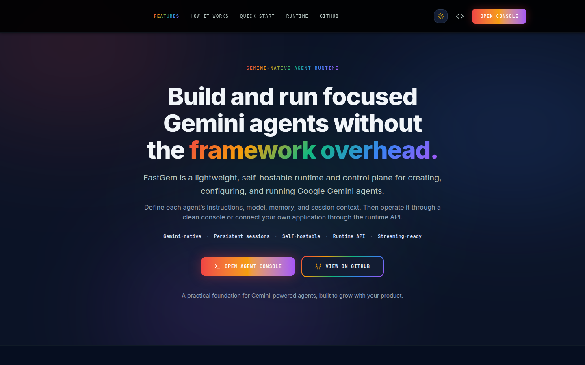
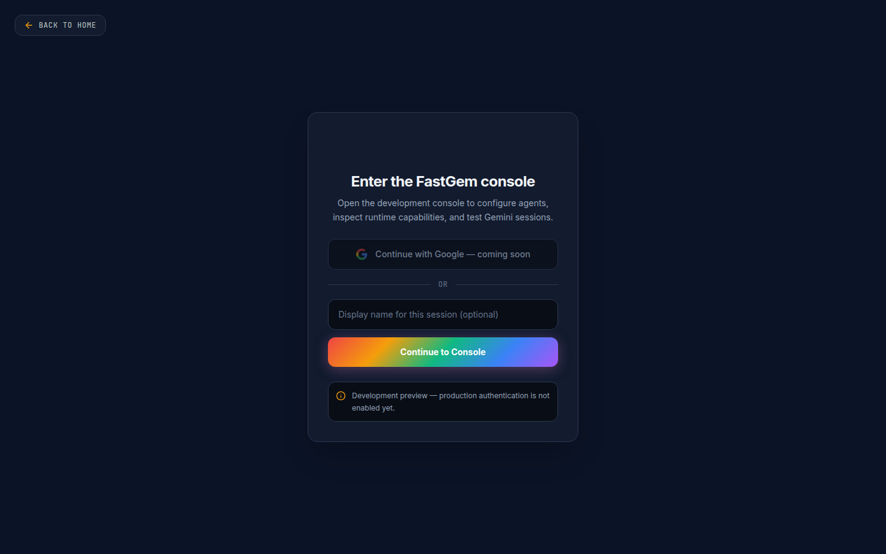
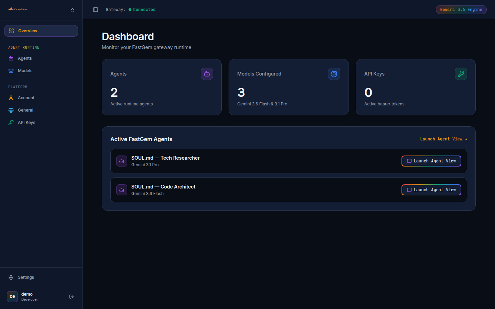
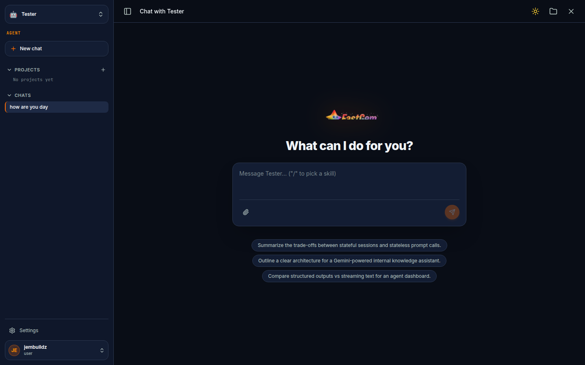

<p align="center">
  
</p>

<h1 align="center">FastGem</h1>

<p align="center">
  <strong>Build and run focused Gemini agents without the framework overhead.</strong><br>
  A lightweight, self-hostable runtime and control plane for Google Gemini agents.
</p>

<p align="center">
  <a href="https://github.com/JQCVSC/FastGem"></a>
  <a href="https://github.com/JQCVSC/FastGem-Landing-page"></a>
  <a href="https://github.com/JQCVSC/FastGem#license"></a>
</p>

---

## What is FastGem?

FastGem is a Gemini-native agent runtime and web control plane. It gives each agent its own identity, system instructions, model configuration, and persistent sessions, then exposes those agents through a clean console and HTTP API.

The project is intentionally focused: a React website and console in front of a TypeScript/Express runtime that calls Google Gemini through `@google/genai`. The current runtime keeps agent and session data in local JSON storage so it is easy to run and inspect during development.

FastGem is not an AI model. It is the runtime and product foundation around Google Gemini.

## Current capabilities

- Gemini-powered agent execution through the FastGem runtime.
- Agent records with names, descriptions, system instructions, models, tools metadata, and timestamps.
- Persistent local sessions and conversation history.
- React console with agent overview, model settings, API-oriented views, and Agent Studio.
- Agent Studio connected to the runtime through `VITE_FASTGEM_RUNTIME_URL`.
- Runtime health, agent, session, run, and streaming endpoints.
- A separate landing-page website that explains the architecture and provides the console entry point.
- Product preview screenshots in [`public/previews/`](public/previews/).

## Architecture

```text
FastGem-Landing-page       FastGem
React website + console  → TypeScript/Express runtime → Google Gemini API
                              ↓
                         local agents/sessions
```

The repositories are intentionally separated:

- **Website and console:** [`JQCVSC/FastGem-Landing-page`](https://github.com/JQCVSC/FastGem-Landing-page)
- **Runtime and API:** [`JQCVSC/FastGem`](https://github.com/JQCVSC/FastGem)

## Local development

Start the runtime first:

```bash
git clone https://github.com/JQCVSC/FastGem.git
cd FastGem
cp .env.example .env
# Add GEMINI_API_KEY to .env
npm install
npm run runtime
```

In a second terminal, start the website:

```bash
git clone https://github.com/JQCVSC/FastGem-Landing-page.git
cd FastGem-Landing-page
cp .env.example .env
# VITE_FASTGEM_RUNTIME_URL defaults to http://localhost:8000
npm install
npm run dev
```

Open `http://localhost:3000` and choose **Open Agent Console**. The current sign-in screen is a development preview gate; it does not yet validate passwords or perform Google OAuth.

### Website environment

```env
VITE_FASTGEM_RUNTIME_URL=http://localhost:8000
```

Set this to the deployed FastGem runtime origin when the website and runtime are hosted separately.

### Runtime environment

```env
GEMINI_API_KEY=
FASTGEM_MODEL=gemini-2.5-flash
FASTGEM_PORT=8000
FASTGEM_DATA_DIR=.fastgem
```

Do not expose the current runtime publicly without adding authentication, HTTPS, rate limiting, secret management, and a durable production datastore.

## Runtime API

The current API surface is:

```text
GET  /health
GET  /api/agents
POST /api/agents
GET  /api/agents/:agentId/sessions
POST /api/agents/:agentId/sessions
POST /api/agents/:agentId/runs
GET  /api/agents/:agentId/runs/stream?prompt=...
```

Use these endpoints to inspect agents, create sessions, submit prompts, and connect another frontend or service to FastGem. The website’s Agent Studio uses the run endpoint and carries the returned session ID across messages.

## Product workflow

1. Define an agent with a purpose, system instructions, and Gemini model.
2. Start the FastGem runtime on a machine or service you control.
3. Point the website at the runtime with `VITE_FASTGEM_RUNTIME_URL`.
4. Enter the console and open Agent Studio.
5. Run prompts through a persistent session or integrate the API into your own application.

## Product previews

FastGem’s website and console are designed as one continuous workflow: discover the runtime, enter the development console, review agents, and open Agent Studio.



_Landing page — Gemini-native positioning, runtime capabilities, and the Open Agent Console entry point._

| Development console entry | Runtime dashboard |
| --- | --- |
|  |  |
| Development preview gate; production authentication is not enabled yet. | Agent overview with models, API-key area, runtime status, and launch controls. |



_Agent Studio — select an agent, start a session, and run prompts through the connected FastGem runtime._

## Roadmap

The next stages are deliberately focused on turning the working vertical slice into a production-ready platform:

- Real production authentication and Google OAuth.
- Durable database support and multi-user workspace isolation.
- Secure sandboxed tool execution.
- Multimodal file and context handling.
- Agent evaluations, usage tracking, and cost visibility.
- Deployment templates and operational configuration.
- External channel integrations.
- Team and workspace permissions.

## Current status

FastGem is an active development project. The runtime, website, console, and Agent Studio are connected, but several dashboard areas remain product surfaces and roadmap foundations rather than fully implemented backend capabilities. README claims should be read alongside the actual runtime code and API behavior.

## License

FastGem is open-source under the **Source-Available Community License**. See the [runtime repository](https://github.com/JQCVSC/FastGem) for the current license text and implementation details.
